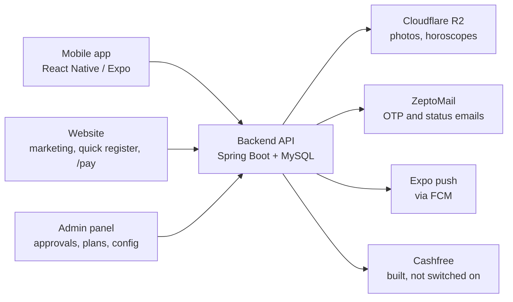
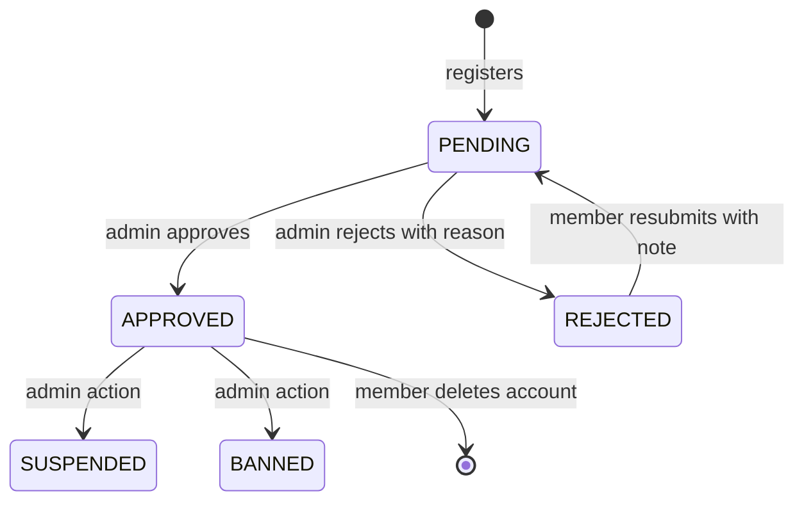
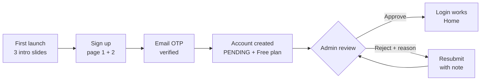
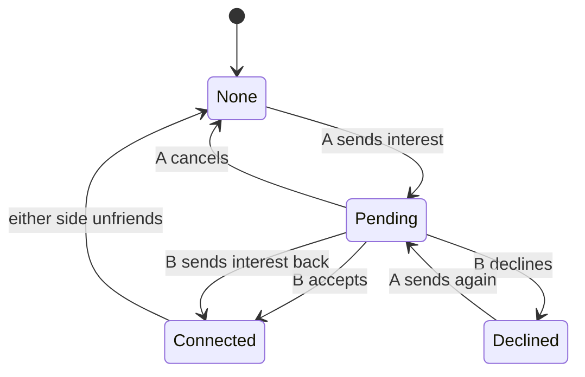
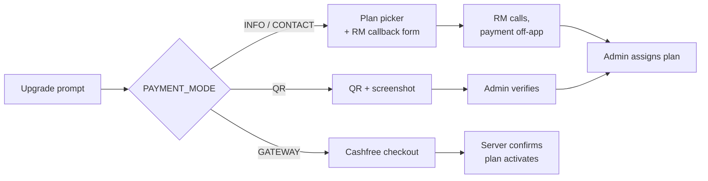

# Vaibhav Vivaaha Matrimony — Business Requirements Document

As of 19 September 2026

## 1. Executive summary

Vaibhav Vivaaha Matrimony is a caste-based Tamil matrimony service delivered as an Android app, a marketing website, an admin panel and one shared backend. The Android app went live on Google Play on 4 September 2026; iOS has not shipped.

Members register, wait for manual approval, browse opposite-gender profiles within their own caste, send interests, and chat once an interest is accepted. Paid plans unlock photos, contact details, advanced search, star matching and assisted services. Plans are sold today through a relationship manager (RM) who takes payment off-app and activates the plan from the admin panel.

This document states what the business needs the product to do, the rules it must enforce, and the issues still open. Technical detail lives in each repository's `CLAUDE.md`.

| Item | Value |
| --- | --- |
| Product | Vaibhav Vivaaha Matrimony |
| Market | Tamil Nadu; 5 castes (Vanniyar, Naidu, Aadi Dravidar, Mudaliar, Free Caste Bar) |
| Live platforms | Android app (Play Store), website `vaibhavvivaahamatrimony.com`, admin panel |
| Live payment mode | `CONTACT` (RM-assisted); `INFO` during Play review |
| Visible profile pool at launch | 175 seeded profiles; broker import of about 1,500 profiles planned |
| Support line | +91 79045 47565 |

## 2. Business objectives

The business earns from paid memberships, so every objective below serves trust in the profiles or conversion to a paid plan. No numeric targets have been set yet; the measures column names what to track once they are.

| # | Objective | How it is measured |
| --- | --- | --- |
| O1 | Give families a trusted place to find a match within their own caste | Share of profiles manually approved; reports and blocks per 1,000 members |
| O2 | Convert free members to paid plans | Free-to-paid conversion; callback requests raised; plans activated per month |
| O3 | Keep registration short so people finish it | Signup completion rate; profile completion % after 7 days |
| O4 | Protect member privacy and consent | Contact reveals only after an accepted interest; zero screenshots of profiles on Android |
| O5 | Stay listed on Google Play | No policy rejections; target API kept within one year of the latest Android release |
| O6 | Let the business change content and pricing display without an app release | Number of changes made through the keyValue configuration rather than a build |
| O7 | Grow the profile pool with real members | Broker campaign: about 1,000 Mudaliar and 500 Vanniyar profiles on the Trial pack |

Open question: the client has not yet given target numbers for O2, O3 and O7.

## 3. Scope

Four systems share one backend and one database; a change to a rule usually touches two of them.

The app, website and admin panel never talk to each other directly; all state lives in the backend.

| System | Repository | Purpose |
| --- | --- | --- |
| Mobile app | `VaibhavVivaahaApp` | Everything a member does after signup |
| Backend | `VaibhavVivaahaBackend` | API, plan gating, notifications, schedulers |
| Admin panel | `VaibhavVivaahaAdmin` | Approvals, plan assignment, configuration, support tickets |
| Website | `VaibhavVivaahaWeb` | Marketing, quick-register lead form, `/open-app`, `/pay/:orderId` |

**In scope**

- Registration, manual approval, login by mobile or email with a 4-digit PIN
- Profile, photos, horoscope, privacy settings, profile completion
- Discovery shelves, search with filters, saved searches, search by member ID
- Interests, connections, chat, block, report
- Contact reveal, call requests, star match, family (parent) logins
- Six membership plans plus the Trial campaign pack, Profile Boost add-on
- Push and in-app notifications, support tickets, FAQ, Terms, Help
- Admin operations and remotely managed content

**Out of scope (not built)**

- In-app voice or video calling; only a request that the RM fulfils
- Google Play Billing
- iOS release
- Languages other than English (i18n is not initialised; Tamil appears only in plan taglines)
- Automated KYC; verification is manual

## 4. Stakeholders and user roles

Five kinds of people use the product; only the first two sign in to the mobile app.

| Role | Who | What they can do |
| --- | --- | --- |
| Member (`USER`) | Bride or groom, or whoever created the profile | Full use of the app within their plan |
| Parent (`PARENT`) | Family member given a login by a Gold or Platinum member | Browse and act on the member's behalf; cannot edit the profile, change the PIN, change privacy or manage family logins |
| Admin | Client's back-office staff | Approve or reject profiles, assign plans, verify ID, education and income, edit configuration, answer tickets, view deleted accounts |
| Relationship manager | Client's sales staff | Receive callback and call requests, take payment off-app, ask admin to activate plans |
| Website visitor | Prospect | Read marketing pages, leave name and mobile as a lead |

**Account states**

Only `APPROVED` members receive a login token. `PENDING` and `REJECTED` members are sent to the verification screen; `SUSPENDED` and `BANNED` members see an account-blocked message.

**Project stakeholders:** the client (product owner and operator), the development team, and Google Play as the distribution gatekeeper.

## 5. Membership plans and entitlements

Four plans are on sale today: Free, Silver, Gold and Platinum. Starter and Classic were retired on 10 August 2026 but existing holders keep their entitlements until expiry. Trial is a campaign pack granted by admin and never sold.

| Plan | Price (₹) | Validity | On sale | Tagline |
| --- | --- | --- | --- | --- |
| Free | 0 | Lifetime | Yes | உங்கள் பயணம் தொடங்குகிறது |
| Starter | 499 | 30 days | Retired | முதல் அடி எடுங்கள் |
| Classic | 999 | 90 days | Retired | தெளிவான தேர்வு |
| Silver | 2,499 | 90 days | Yes | இதயம் திறக்கும் நேரம் |
| Gold | 4,999 | 180 days | Yes | தங்க வாழ்க்கை தொடர்புகள் |
| Platinum | 9,999 | Until marriage | Yes | திருமணம் வரை நம்மோட உதவி |
| Trial | Not sold | Set per cohort | Admin grant only | — |

**Entitlement matrix.** "req" means the member raises a request that staff fulfil.

| Feature | Free | Starter | Classic | Silver | Gold | Platinum |
| --- | --- | --- | --- | --- | --- | --- |
| Basic search, profile views | Yes | Yes | Yes | Yes | Yes | Yes |
| Interests sent per plan period | 3 | 25 | 60 | Unlimited | Unlimited | Unlimited |
| Chat | No | 5 conversations | Unlimited | Unlimited | Unlimited | Unlimited |
| Shortlist, notifications | No | Yes | Yes | Yes | Yes | Yes |
| Full profile photos | No | Yes | Yes | Yes | Yes | Yes |
| Who liked you | No | Yes | Yes | Yes | Yes | Yes |
| Advanced filters (education, city, star, dosham, horoscope-only) | No | No | Yes | Yes | Yes | Yes |
| Horoscope view, daily match alert | No | No | Yes | Yes | Yes | Yes |
| Star match score | No | No | Basic | Full | Full | Full |
| Contact reveals | No | No | 40 | Unlimited | Unlimited | Unlimited |
| Who viewed you | No | 5 | 20 | Unlimited | Unlimited | Unlimited |
| Subcaste search | No | No | No | Yes | Yes | Yes |
| Voice call request, SecureConnect, verification badge | No | No | No | Yes (req) | Yes (req) | Yes (req) |
| Profile boosts per month | 0 | 0 | 0 | 0 | 2 | 5 |
| Who shortlisted you, family login, WhatsApp share, video profile, priority search | No | No | No | No | Yes | Yes |
| Speak with families, dedicated RM, assisted matchmaking | No | No | No | No | No | Yes (req) |

**Trial pack:** Silver's features without unlimited requests or SecureConnect; 25 interests and 5 contact reveals per plan period; chat unlimited.

**Rules**

- BR-P1. The `planFeatures` table is the source of truth; this matrix is a summary and must be re-checked against it before any pricing decision.
- BR-P2. Retiring or re-activating a plan is a single `isActive` flag change. Upsell copy must name the lowest plan currently on sale that grants the feature, never a fixed plan name.
- BR-P3. A quota is shown to the member as "X of N left"; when it is used up the app says so and offers an upgrade.
- BR-P4. An expired plan grants nothing. The nightly job marks it expired, and both server and app must treat end-of-day on the end date as the cut-off.
- BR-P5. Verification badge, prime verified, high visibility and priority search have database rows but no code reads them yet.

## 6. Registration, approval and login

A person can use the app only after an admin has approved the profile; registration itself is kept to two short pages.

The intro slides show once per install and never again, including after logout.

| ID | Requirement |
| --- | --- |
| FR-R1 | Page 1 collects first name, last name, date of birth, gender, age (derived), email with OTP verification, mobile, caste and subcaste. Page 2 collects education, occupation, employing in, district, PIN and confirm PIN. |
| FR-R2 | Every field is mandatory. Subcaste is mandatory only when the chosen caste has subcastes; each such caste offers "Others". |
| FR-R3 | The member must be at least 18. The same rule applies when the date of birth is edited later, on the app and on the server. |
| FR-R4 | Mobile must be 10 digits starting 6–9. Names reject leading spaces, collapse repeated spaces, cap at 50 characters and are trimmed. |
| FR-R5 | Create Account stays disabled until the form is valid, and a second tap cannot create a second account. |
| FR-R6 | One email and one mobile map to one account. A registered email returns "already registered, please sign in". |
| FR-R7 | On success the only exit is a "Go to Login" button. On a timeout the app tells the member the account may exist and to try signing in first. |
| FR-R8 | A new account is `PENDING`, holds the Free plan, and shows about 25% profile completion. |
| FR-R9 | Admin approves or rejects with a reason. Approval and rejection emails open the app through `/open-app`. |
| FR-R10 | A rejected member can resubmit with an optional note of up to 250 characters, shown to the admin and cleared once acted on. |
| FR-L1 | Login accepts a 10-digit mobile or an email, plus the 4-digit PIN. No OTP is needed to log in. |
| FR-L2 | A wrong mobile, email or PIN all return one message, "Invalid Credentials", so accounts cannot be enumerated. |
| FR-L3 | Forgot PIN runs by email OTP and a reset token. Changing the PIN from Settings requires the current PIN. |
| FR-L4 | The login screen has no back button, and the Android back key exits the app. Every route to login replaces the stack. |
| FR-L5 | Logout removes the device's push registration, clears stored session data and the cached plan, and keeps only the "intro seen" flag. |
| FR-L6 | Delete account requires typing DELETE, accepts an optional reason, and records a tombstone (who, plan, reason, when) for the admin list. |

## 7. Profile, photos, horoscope and privacy

A member's own profile is edited one section at a time on a full page, using the same master lists as registration and search so that an edit can never make a profile unsearchable.

| ID | Requirement |
| --- | --- |
| FR-P1 | Sections: Personal, Religious, Job and Education, Family, Interests and Hobbies, About, Photos, Horoscope. |
| FR-P2 | Dropdown values for education, employing in, annual income, star and dosham come from the central keyValue lists, never from lists held in the app. |
| FR-P3 | Registration fields stay mandatory when edited. Inputs have length caps: names 50, occupation 60, address and education-in-detail 200 with a counter, job place 100. |
| FR-P4 | Gender, religion, caste, subcaste, mobile and email are read-only, with "Contact support to change" shown on mobile and email. |
| FR-P5 | Number of siblings is derived from brothers plus sisters; married counts cannot exceed their totals. |
| FR-P6 | Leaving an edit page with unsaved changes asks first, including through the Android back key. |
| FR-P7 | A name change shows on the home header without logging in again. |
| FR-P8 | Interests are chosen from chips, minimum 3. They always appear on the profile another member sees, with "No interests added yet" when empty. |
| FR-P9 | One profile photo plus up to 3 gallery photos, shown as X/3. A gallery photo can be set as profile photo, replaced in place, or removed. |
| FR-P10 | Only JPG, PNG, WEBP and HEIC are accepted. Images are resized to 1600 px at quality 0.7 before upload, and a progress overlay shows while uploading. |
| FR-P11 | One horoscope image can be added, replaced or deleted. Another member opens it full screen by tapping it. |
| FR-P12 | Upload and save errors show plain wording; raw server text is never shown. "Image too large" keeps its specific message. |
| FR-P13 | Profile completion % counts the 9 registration fields plus 26 later ones and refreshes straight after any edit. |
| FR-P14 | Privacy settings let a member hide mobile number, profile photo and horoscope. Another member must then request access, and the owner approves or declines. |
| FR-P15 | Decided access requests stay in the Permissions list with an Approved or Declined chip; pending ones sort first. |
| FR-P16 | Empty values show as "-". Height, weight, mother tongue and annual income are formatted for reading rather than shown as stored. |
| FR-P17 | Screenshots and screen recording are blocked on Android for every member. |

## 8. Discovery, search and star match

Every list a member sees is limited to the opposite gender within the member's own caste, excluding inactive, blocked and unapproved profiles.

| ID | Requirement |
| --- | --- |
| FR-D1 | Home shows shelves: Daily Recommendation (reshuffles at midnight), New Connections, Near You, Interest-Based Matches and All Matches. A shelf with no profiles is hidden. |
| FR-D2 | Home shows four counters that open their lists: Likes, Proposals (opens Sent By You), Views and Matches. |
| FR-D3 | Free members see profile photos blurred with a lock; paid plans show a tier badge on cards. |
| FR-D4 | Explore offers three tabs: By Criteria, By Profile ID and Saved Search. |
| FR-D5 | Criteria: age 18–60, annual income 0–99 lakh, subcaste, education, job sector, city, star, dosham, photos only and horoscope only. An untouched or full-span slider means no filter. |
| FR-D6 | Locked filters show a lock and open the standard upgrade prompt. The server ignores filters the member is not entitled to. |
| FR-D7 | Clear resets every control, including both sliders, to its default. |
| FR-D8 | A search can be saved with a name, reloaded (restoring every control) and deleted. Loading one that uses a filter above the member's plan prompts an upgrade. |
| FR-D9 | Search by member ID (for example `BLK101F`) opens that profile if it is in the member's scope. |
| FR-D10 | Results show one full-photo card per profile with name, age, height, city, job, income, tier and verified badges. |
| FR-D11 | Every empty list shows a centred message with an action: Explore Matches, or Start a New Search on Saved Search. |
| FR-D12 | A quick-access floating button, draggable on every signed-in screen, opens shortcuts managed from the server. Shortcuts above the member's plan show a lock. |
| FR-S1 | Star match compares two horoscopes on the traditional porutham factors and returns a score with a per-factor breakdown. |
| FR-S2 | Star match against a specific member requires a paid plan and an accepted interest with that member. The standalone calculator needs only the plan. |

**Data rule.** Values stored on profiles must match the dropdown lists exactly. This failed for star, dosham, income, district and education; all but education were fixed by normalising the data. Any new dropdown must be checked against stored values before release.

## 9. Interests, connections, chat, block and report

Two members are connected only when an interest between them has been accepted; chat, contact, horoscope, call requests and star match all depend on that one fact.

If both members send each other an interest, the pair is treated as one connection, not two records that can disagree.

| ID | Requirement |
| --- | --- |
| FR-I1 | Sending an interest spends one of the plan's requests and cannot be double-submitted. Failures show the server's reason. |
| FR-I2 | The Request tab has Received (filter by pending, accepted, declined), Sent By You and Permissions. Lists refresh each time the tab is opened. |
| FR-I3 | A declined interest can be sent again, with no waiting period. |
| FR-I4 | Either member can unfriend, from the profile menu or the Request tab. Earlier messages are kept; a thread holding only the automatic system lines is removed. |
| FR-I5 | After unfriending, the chat cannot be opened or written to until a new interest is accepted. The member is told to send an interest first and offered View Profile. |
| FR-C1 | Chat is one-to-one, in real time, with messages in strict time order and sent, delivered and read ticks. |
| FR-C2 | A member without the chat entitlement sees only that a message arrived, never its text, in the list, the notification and the push. |
| FR-C3 | Deleting a conversation hides it for that member only. It returns when either side sends a new message. History is never erased. |
| FR-C4 | Only a participant can delete or read a conversation. |
| FR-B1 | Blocking hides each member from the other everywhere. The blocked member is not told: their messages show a single grey tick and are never delivered. |
| FR-B2 | A blocked list in Settings allows unblocking, which restores normal behaviour at once. |
| FR-B3 | A profile or a single chat message can be reported with one shared reason list: Fake Profile, Inappropriate Photos, Already Married, Underage, Scam / Financial Fraud, Spam, Abuse, Harassment, Others. |
| FR-B4 | "Also block this user" is ticked by default when reporting a profile and unticked when reporting a message. |
| FR-B5 | Follow, like and shortlist actions must be idempotent; a second tap never creates a duplicate or breaks the undo. |

## 10. Contact reveal, call requests, family access and notifications

A member's phone number, email and horoscope are released only to a connected member whose plan allows it; buying a plan alone never exposes anyone's contact details.

| ID | Requirement |
| --- | --- |
| FR-V1 | Without an accepted interest the mobile shows masked to its last 4 digits and the email is withheld. |
| FR-V2 | Plans with unlimited access (Silver and above) see contact details once connected. Plans with a numbered quota (Classic 40, Trial 5) tap "Reveal Contact & Horoscope" and see "X of N reveals left". |
| FR-V3 | A refused reveal, because the pair is not connected, does not spend a reveal. |
| FR-V4 | The reveal button must depend on the plan having a numeric quota, not on a plan name, so any future pack works without an app change. |
| FR-V5 | The horoscope shows only when the plan allows it and the interest is accepted. When the member has none, the app says so instead of implying a lock. |
| FR-V6 | Request Call (Silver and above) raises a request for the RM to arrange the call. It needs an accepted interest, and duplicates of a pending request are refused. |
| FR-V7 | The member being called receives a push and an in-app notification as soon as the request is made. |
| FR-V8 | When Request Call or Match Score is locked, an info icon beside the label explains why on tap. |
| FR-V9 | My Requests lists the member's service requests with their status. |
| FR-V10 | WhatsApp share (Gold and above) sends a link to the profile that opens the app when installed, else the website. |
| FR-F1 | Gold and Platinum members can create family logins with a name, relationship, mobile and 4-digit PIN, and can revoke them. |
| FR-F2 | A family login acts on the member's data but cannot edit the profile, photo, privacy, PIN or family logins. A banner names who is signed in. |
| FR-N1 | Every member, on any plan, is notified of: interest received, interest accepted, new message, call request, and a decision on their access request. |
| FR-N2 | Profile views, likes, shortlists and daily matches notify paid members only. |
| FR-N3 | Paid recipients see the other member's name; free recipients see "Someone". A lookup failure shows "Someone", never a name. |
| FR-N4 | Notification text uses plain words, never internal codes. |
| FR-N5 | A device stops receiving pushes when the member logs out. A failed registration repairs itself the next time Home opens. |

## 11. Payments and the payment mode switch

How a member pays is decided by one server setting, `PAYMENT_MODE`, which changes every purchase screen within 5 minutes and needs no app release.

| Mode | What the member sees | When it is used |
| --- | --- | --- |
| `INFO` | Plan features only. No prices and no purchase button anywhere. | While any app update is under Google Play review |
| `CONTACT` | Prices shown. "Talk to a Relationship Manager": callback form, tap-to-call, WhatsApp. | Live today |
| `QR` | UPI QR code, screenshot upload, admin verifies and activates. | Built; not live in the app |
| `GATEWAY` | "Pay securely" opens Cashfree checkout in the system browser, then a status screen. | Built; must not be switched on in the app yet |

In every mode the plan takes effect only after the server records it.

| ID | Requirement |
| --- | --- |
| FR-M1 | The plans screen shows one card per plan on sale, with price, validity, price per day, tagline and a checklist drawn from the live entitlement table. The member's current plan is marked. |
| FR-M2 | An upgrade prompt opens once per tap, however many times it is tapped, and never waits more than about 0.7 seconds on the network. |
| FR-M3 | The callback form captures name, mobile, plan of interest, best time to call and a note. It works for a guest without an account. |
| FR-M4 | In `GATEWAY` the amount is set by the server from the plan, never by the app. The status screen checks for about 40 seconds and offers retry on failure. |
| FR-M5 | Profile Boost (₹149 extra boost) follows the same mode as plans; no screen may show a payment method the mode forbids. |
| FR-M6 | A payment already in progress can always be resumed. |
| FR-M7 | The UPI QR image can be replaced from the server, with the bundled image as fallback. |
| FR-M8 | Admin can assign a plan to a member directly, and the member is emailed. |

**Operating rule.** Switch to `INFO` before submitting any update to Google Play, and back to `CONTACT` after approval.

## 12. Support, help content and admin operations

Members reach the team through a ticket, a call, WhatsApp or email, and the team runs the service from the admin panel without developer help.

| ID | Requirement |
| --- | --- |
| FR-H1 | Help & Support shows tap-to-call, WhatsApp and email, support hours, quick help, and a message form with a category (Technical, Account, Matching, Payment, Safety, Other). |
| FR-H2 | Submitting the form creates a real support ticket, the same kind the support chat uses, and confirms a reply within 24 hours. |
| FR-H3 | A draggable support chat bubble on the Settings screen shows the member's ticket conversation with an unread badge, and stays visible above the keyboard. |
| FR-H4 | FAQ is searchable and filterable by 6 categories, and links to Help & Support. |
| FR-H5 | FAQ, Terms and support details are edited on the server. The app falls back to bundled text and never shows an empty page. |
| FR-H6 | A promotional popup can target chosen plans and a display frequency. A version prompt can nudge or force an update. Both are off today. |
| FR-A1 | Admin reviews pending profiles, sees a resubmission note, and approves or rejects with a reason. |
| FR-A2 | Admin verifies ID, education and income documents, and rejects unsuitable photos. |
| FR-A3 | Admin assigns plans, grants Trial cohorts with a cohort tag, and edits the plan-by-feature matrix. |
| FR-A4 | Admin edits configuration: payment mode, RM contact, quick-access menu, banners, app version, FAQ, Terms, support content, master lists. |
| FR-A5 | Admin works callback requests and service requests through a status. |
| FR-A6 | Admin reads reports (profile or message), suspends or bans members, and sees the deleted-accounts list with plan and reason. |
| FR-A7 | Admin answers support tickets. |

## 13. Cross-cutting business rules

These rules apply to every feature and have each been broken at least once; any new feature must be checked against them.

| ID | Rule |
| --- | --- |
| BR-1 | **Consent before contact.** Contact details, horoscope, call requests and member-to-member star match need an accepted interest. Plan level alone is never enough. |
| BR-2 | **The server decides.** Every plan gate is enforced on the server; the app only hides or locks the control. |
| BR-3 | **Check the result, not the reply.** The backend answers most failures with HTTP 200 and a code in the body. Every caller must read that code. "Not found" on a list means empty, not an error. |
| BR-4 | **Only live plans count.** Entitlements come from the member's latest active, unexpired subscription. |
| BR-5 | **No plan names in copy.** Upgrade wording resolves the lowest plan on sale that grants the feature. |
| BR-6 | **One vocabulary per field.** Dropdown lists and stored profile values must match exactly, in the app, the admin panel and imports. |
| BR-7 | **Pairs can have two records.** Any lookup "between two members" must expect more than one row. |
| BR-8 | **Actions are idempotent.** Send interest, follow, shortlist, upgrade and register must survive a double tap or a retry. |
| BR-9 | **Delete means hide.** Conversations and messages are hidden per member and retained for moderation. |
| BR-10 | **A family login is scoped.** It can browse and act but cannot change the member's identity, security or privacy. |
| BR-11 | **Names are a paid benefit** in notifications; failures default to anonymous. |
| BR-12 | **Identity fields are support-only.** Mobile, email, gender and caste cannot be self-edited. |
| BR-13 | **One look.** Empty, error and locked states use the same blue centred layout; gold is reserved for the upgrade popup and tier badges. |
| BR-14 | **Members must be 18 or older**, enforced at signup, on edit and on the server. |
| BR-15 | **Never invent master data.** Subcaste names and similar lists come from the client. |

## 14. Non-functional requirements

The security requirements below are not met today; the rest are met or have a named check.

| ID | Area | Requirement | Status on 19 Sep 2026 |
| --- | --- | --- | --- |
| NFR-1 | Security | Every API call except login, signup, OTP, public config and the payment webhook requires a valid token, and the server takes the member's identity from that token. | Not met. The server permits all requests and the app sends no token. |
| NFR-2 | Security | PINs are stored with a one-way hash. OTPs are never returned in an API response. | Not met. PINs are Base64-encoded. |
| NFR-3 | Security | No secrets in the repository; signing keys and passwords stay out of version control. | Partly met. Signing keys are excluded; `.env` is committed. |
| NFR-4 | Privacy | Android blocks screenshots and recording. Contact data is masked server-side. Logs carry no personal data in release builds. | Met |
| NFR-5 | Privacy | The privacy policy and the Play Data Safety form match the permissions the app requests. | Met; must be re-checked if calling or a payment gateway goes live. |
| NFR-6 | Performance | A tap navigates at once. Lists over 10 rows paginate. Images upload at about 150–400 KB. App requests time out at 10 s, uploads at 60–120 s, signup at 30 s. | Met |
| NFR-7 | Availability | One slow outside service must not freeze the API; outbound calls have timeouts. | Email fixed; emails are still sent inside the request. |
| NFR-8 | Platform | Android 7.0 (API 24) and up, target API 36, portrait, edge-to-edge. Keyboard never covers the focused field. | Met on tested devices |
| NFR-9 | Compliance | No off-platform purchase flow is visible to a Play reviewer. No unused sensitive permission is requested. | Met by operating rule (section 11) |
| NFR-10 | Content integrity | Profiles shown to members and in store listings are real or clearly owned; no unlicensed photos. | Not met. 80 of 92 seeded photos are hotlinked from Pinterest, Wix and Reddit. |
| NFR-11 | Data integrity | One account per email and per mobile; pair tables have unique constraints. | Partly met. Checked in code; database constraints still missing. |
| NFR-12 | Maintainability | Each repository's `CLAUDE.md` is updated with every change. The app's type-check error count does not rise above its baseline of 56. | Met |
| NFR-13 | Accessibility and language | English only. Fonts are Rubik, set through style so they render on Android. | Met |

## 15. Data, integrations and remote configuration

Most business content is a row in the `keyValue` table, so the client can change it from the admin panel and members see it without installing anything.

| Key | Controls | Reaches members in |
| --- | --- | --- |
| `PAYMENT_MODE` | INFO, CONTACT, QR or GATEWAY | 5 minutes |
| `ADMIN_CONTACT` | RM name, title, photo, phone, WhatsApp, callback hours | Next screen open |
| `PAYMENT_QR` | UPI QR image | Next screen open |
| `QUICK_ACCESS_MENU` | Floating-button shortcuts and their minimum plan | 30 minutes |
| `APP_VERSION` | Soft and forced update prompts | Next launch |
| `promotionalPopupBanner` | Promo image, action, audience plans, frequency | Next launch |
| `FAQ_CONTENT`, `TERMS_CONTENT`, `SUPPORT_CONTENT` | Help pages | 6 hours |
| `education`, `employingIn`, `annualIncomeRegister`, `districts`, `star`, `dosham` | Dropdown lists for signup, edit and search | Next master-data load |

Plans on sale come from `subscription_plans.isActive`, cached 30 minutes. A new shortcut in `QUICK_ACCESS_MENU` also needs an app change, because shortcuts map to fixed destinations.

**Main data**

| Entity | Holds |
| --- | --- |
| Users, user details | Identity, status, caste and subcaste, profile fields, JSON blocks for family, astrology and hobbies |
| Subscriptions, plans, features, plan features, feature usage | What a member is entitled to and how much is used |
| Interest requests, conversations, chats | Connections and messages, with per-member hide and hidden-from-receiver flags |
| Restricted field requests, contact reveals | Consent to see hidden fields and spent reveals |
| Service requests, callback requests, support tickets | Work queues for staff |
| Notifications, device information | In-app list and push targets |
| Blocked users, reports, deleted accounts | Safety and audit |
| Family logins, gallery, saved searches, payment requests, Cashfree orders | Supporting records |

**Integrations**

| Service | Used for |
| --- | --- |
| Cloudflare R2 | Photos, horoscopes, QR and support images |
| ZeptoMail | OTP, approval, rejection and plan-assigned emails |
| Expo push over Firebase | Push notifications; only Expo tokens are valid |
| WebSocket (SockJS/STOMP) | Live chat and presence |
| Cashfree | Online checkout; website-ready, app switched off |
| Android App Links | Shared profile links and `/open-app` opening the app |

Indexes and unique constraints are applied by hand; any new environment needs `migration-indexes-simple.sql` run and verified.

## 16. Risks, open issues and pending decisions

The first four items can harm members or the listing and should be settled before the broker import brings in real profiles at scale.

| # | Severity | Issue | Needed from |
| --- | --- | --- | --- |
| R1 | Critical | The API has no authentication. Anyone who knows an endpoint can read or change any member's data, including delete account, change PIN and read chat. | Development: re-enable tokens on server and app together |
| R2 | Critical | PINs are stored reversibly (Base64). | Development: hash, with a migration on next login |
| R3 | High | 80 of 92 seeded profile photos are hotlinked images of real people with no licence. They must not appear in store screenshots or stay in the pool. | Client: supply owned images or approve removal |
| R4 | High | Turning on `GATEWAY` in the app counts as alternative billing under Play policy. It needs the Play alternative-billing enrolment for India and a privacy policy update first. | Client: decide whether to enrol |
| R5 | High | Duplicate accounts exist (users 913/914, the 901–906 batch, one email on 30 accounts). A unique index on email cannot be added until they are cleaned. | Client: confirm which to remove |
| R6 | Medium | Education search reaches about 9 of 600 profiles: the dropdown offers categories (UG, PG, ENGINEER) while profiles hold degree names (B.Tech, M.Sc). | Client: decide the vocabulary when real data is imported |
| R7 | Resolved | Closed 20 Sep 2026. Every reference table found wrong in July 2026 has since been corrected, and all six were checked against the classical sources: Nadi (all 27 stars), Stree Dirga (threshold 13), Yoni (14 animals), Gana, Vasya (five groups) and Rasi Adhipathi (Naisargika Maitri). No table is now known to be wrong. | None. Re-verify only if a new porutham factor is added. |
| R8 | Medium | Emails are sent inside the member's request, so a slow mail service still delays signup and approval. | Development: move to a background queue |
| R9 | Medium | Android App Links need the Play app-signing certificate fingerprint added to `assetlinks.json`, and the rejection email template's button must use the app-link variable. | Client: fingerprint from Play Console; check the ZeptoMail template |
| R10 | Medium | User 925 registered with a 9-digit mobile before the rule existed and can never log in by mobile. | Client: fix or delete |
| R11 | Low | Six profiles hold a district no longer offered (Pune, Kolkata). Stale push tokens that are not Expo tokens remain. Image upload limit on the web server is still 1 MB. | Development, at next maintenance |
| R12 | Low | Family logins are unlimited per member and the parent gets no OTP. The parent scope guard covers Settings and Profile only. | Client: decide a cap and whether to verify the parent's number |
| R13 | Low | Four plan features (verification badge, prime verified, high visibility, priority search) are sold on the matrix but have no effect in code. | Client: build them or remove them from the checklist |

**Pending decisions**

- Numeric targets for conversion, signup completion and the broker campaign.
- Whether iOS is planned, and when.
- Whether Tamil language support is wanted beyond plan taglines.
- Whether a member may accept or decline a call request in the app, rather than the RM arranging it.
- Whether profile cards and the count badge on list screens move from maroon to the blue theme.

## 17. Release procedure and glossary

A release is three separate deployments, and a change is not live until each part it touches has gone out.

| What changed | How it goes live |
| --- | --- |
| Server configuration (keyValue, plan flags, master lists) | Edit in admin panel or database; no build |
| Backend code | Build the jar and deploy; new columns are created automatically, indexes are not |
| Admin panel or website | Build and deploy the static bundle |
| Mobile app | New signed Android bundle with a higher `versionCode`, uploaded to Play |

**Before every Play upload**

1. Set `PAYMENT_MODE` to `INFO`.
2. Confirm `EXPO_PUBLIC_ALLOW_SCREENSHOTS` is commented out in `.env`.
3. Raise `versionCode`.
4. Build with the upload key; the build fails if `keystore.properties` is missing.
5. Confirm the demo account (mobile 6379829750, Platinum, approved) still logs in.
6. After approval, set `PAYMENT_MODE` back to `CONTACT`.

The upload key file and its passwords must be kept permanently; losing them ends the ability to update the app under this package name.

**Glossary**

| Term | Meaning |
| --- | --- |
| Interest | A request from one member to connect with another |
| Connected | An interest between two members has been accepted |
| Unfriend | Remove a connection; messages are kept, chat is closed |
| Reveal | Spending one unit of a plan's quota to see a connected member's contact and horoscope |
| Restricted field | Mobile, photo or horoscope a member has hidden, released on request |
| Service request | A member's request that staff fulfil, such as a voice call |
| Callback request | A lead asking the RM to call about a plan |
| RM | Relationship manager, the client's sales contact |
| Trial pack | Unsold campaign plan granted to imported broker profiles |
| Porutham / star match | Traditional horoscope compatibility score |
| Dosham | Astrological affliction recorded on a profile and used as a filter |
| keyValue | Server table of settings and content the client can edit |
| Family login | A parent's sign-in to a Gold or Platinum member's account with limited rights |
| Member ID | Public profile identifier such as `BLK101F` or `UMR000123` |
